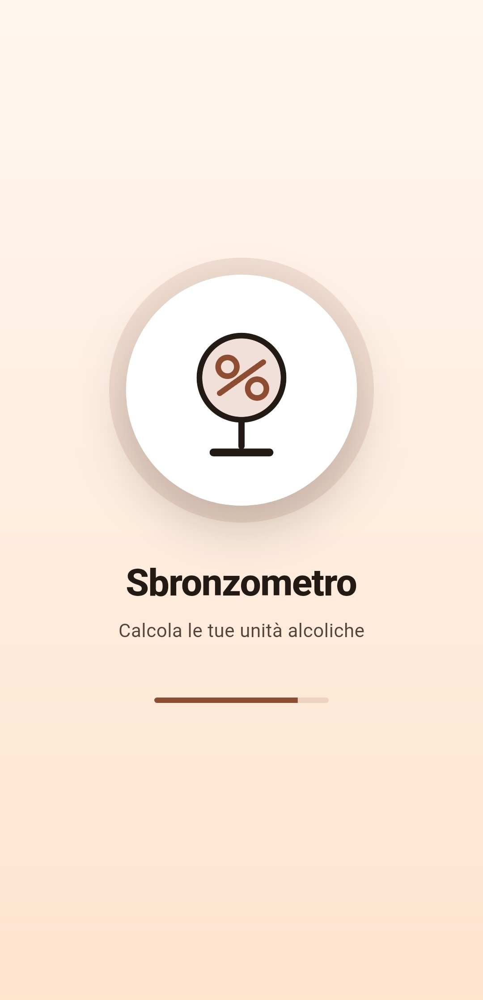
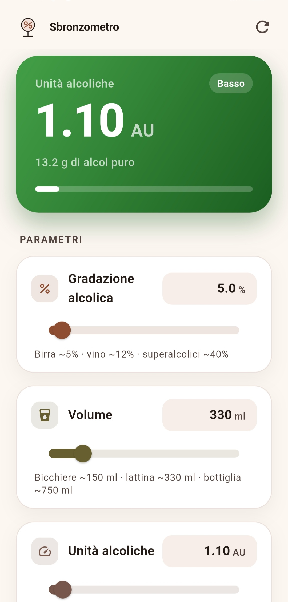
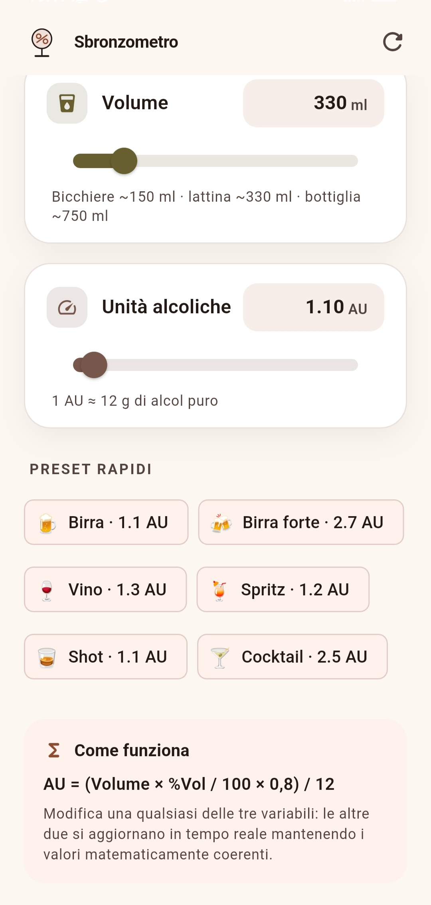

<div align="center">


# Sbronzometro

**Calcola le tue unità alcoliche in modo semplice e immediato.**

Un'app Flutter minimale e reattiva per calcolare alcol by volume, volume della bevanda
e unità alcoliche (AU) in tempo reale.

[](https://flutter.dev)
[](https://dart.dev)
[](#android)
[](#android)
[](#android)

</div>

---

## Screenshot

<div align="center">

<table>
  <tr>
    <td align="center"></td>
    <td align="center"></td>
    <td align="center"></td>
  </tr>
  <tr>
    <td align="center"><b>Splash animato</b></td>
    <td align="center"><b>Calcolo reattivo</b></td>
    <td align="center"><b>Preset rapidi</b></td>
  </tr>
</table>

</div>

---

## Panoramica

Sbronzometro risolve un unico problema: capire **quante unità alcoliche** stai assumendo.
Le tre variabili in gioco sono collegate da un'unica equazione, quindi bastano due valori
per determinare il terzo. Modifica quello che conosci e l'app calcola il resto all'istante.

- **Gradazione alcolica (% Vol)** — es. 5.0% birra, 12.0% vino, 40.0% superalcolici
- **Volume (ml)** — es. 330 ml, 500 ml, 750 ml
- **Unità alcoliche (AU)** — 1 AU ≈ 12 g di alcol puro

## Funzionalità

- **Doppio input per ogni variabile**: slider fluido per le regolazioni rapide e campo
  numerico con tastiera numerica per l'inserimento preciso.
- **Calcolo a 3 variabili completamente reattivo**: cambi un valore e gli altri due si
  aggiornano in tempo reale, mantenendo la coerenza matematica.
- **Feedback visivo immediato**: la card del risultato anima colore, numero e misuratore
  in base alle unità calcolate.
- **Preset rapidi** per le bevande più comuni (birra, vino, spritz, shot, cocktail...).
- **Tema chiaro e scuro** automatico, in base all'impostazione di sistema.
- **Splash screen animato** con il logo dell'app.
- **Icona adattiva** per Android 8+.

## Come funziona

La formula di riferimento:

```
AU = (Volume_ml × (%Vol / 100) × 0,8) / 12
```

dove `0,8` è la densità dell'etanolo in g/ml e `12` sono i grammi di alcol puro contenuti
in una unità alcolica (AU).

Poiché una sola equazione lega tre incognite, l'app applica una regola precisa per
mantenere lo stato sempre coerente:

| Variabile modificata | Valore mantenuto | Valore calcolato |
| -------------------- | ---------------- | ---------------- |
| Gradazione (% Vol)   | Volume           | AU               |
| Volume (ml)          | Gradazione       | AU               |
| Unità alcoliche (AU) | Gradazione       | Volume           |

> Il model usa un **lock di rientranza** che ignora le mutazioni durante un aggiornamento:
> così una singola modifica dell'utente produce esattamente un aggiornamento coerente,
> senza loop di ricalcolo infiniti.

## Struttura del progetto

```
sbronzometro/
├── android/                        # Progetto Android nativo
├── assets/
│   └── icon/                       # Sorgenti dell'icona (legacy + adattiva)
├── lib/
│   ├── main.dart                   # Entry point, temi e transizione splash → home
│   ├── models/
│   │   └── alcohol_calculator.dart # Logica di calcolo a 3 variabili (ChangeNotifier)
│   ├── screens/
│   │   └── home_screen.dart        # UI principale
│   ├── theme/
│   │   └── app_theme.dart          # Temi chiaro/scuro
│   └── widgets/
│       ├── animated_splash_screen.dart
│       ├── drink_logo.dart         # Logo disegnato con CustomPainter
│       ├── result_card.dart        # Card del risultato con animazioni
│       └── variable_control.dart   # Slider + campo numerico riutilizzabile
├── screen/                         # Screenshot per il README
├── test/
│   └── widget_test.dart            # Test della logica reattiva e della UI
└── pubspec.yaml
```

## Installazione

Requisiti: **Flutter 3.47+** con **Dart 3.13+**.

```bash
# Clona il repository
git clone https://github.com/TUO_USERNAME/sbronzometro.git
cd sbronzometro

# Installa le dipendenze
flutter pub get

# Avvia l'app
flutter run
```

## Build

```bash
# APK di release
flutter build apk --release

# App Bundle per il Play Store
flutter build appbundle --release
```

## Icone

L'icona è generata da `assets/icon/app_icon.png` (legacy) e
`assets/icon/app_icon_foreground.png` (adattiva) tramite `flutter_launcher_icons`.
Per rigenerarla dopo aver modificato i sorgenti:

```bash
dart run flutter_launcher_icons
```

## Test

```bash
flutter test
```

## Android

- **compileSdk / targetSdk**: 35
- **minSdk**: 21 (compatibilità con versioni Android precedenti, dove possibile)
- Il target principale è **Android 13 (API 33) e versioni successive**.
